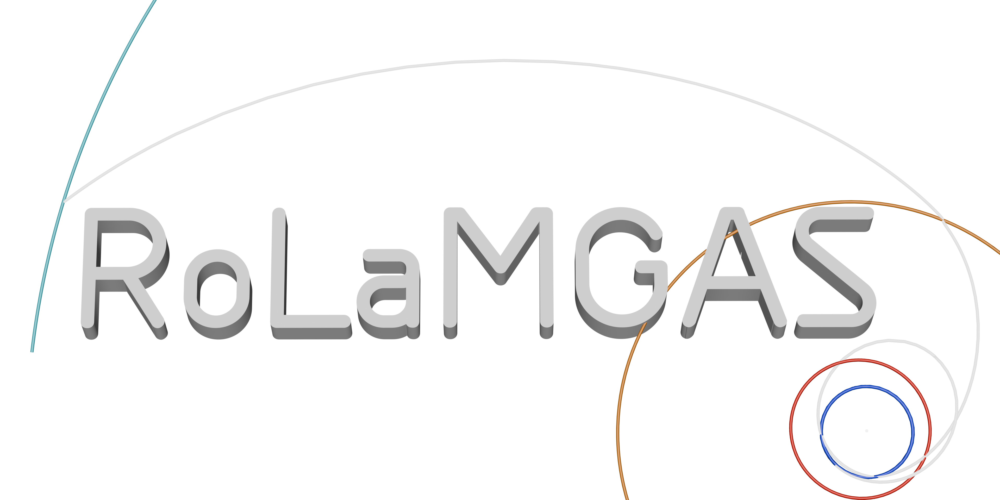

# RoLaMGAS

**Robert's Lambert Multi Gravity Assist Solver**

[Explore the live trajectory gallery](https://robertbarthellgaray.github.io/RoLaMGAS/) · [Windows download & releases](https://github.com/robertbarthellgaray/RoLaMGAS/releases/tag/rolamgas-preview-v0.1) · [Robert’s portfolio](https://robertbarthellgaray.github.io/)

## Browse before downloading

The GitHub Pages site includes 92 precomputed examples: all seven planetary destinations, Pluto, Eris, 2026 ED138, and the integrated CLAUDIUS/UOP and reconstructed Tianwen-4 concepts. Filter by destination, assist sequence, launch C3, cruise burn budget or arrival speed. Rotate the saved paths, play the mission timeline, inspect TDB event dates, and download the candidate data or plot. The two integrated concepts also offer their original XYZV files.

Public Lambert admission independently recomputes flyby speeds and turning geometry: excess-speed mismatch ≤1 m/s, each DSM ≤700 m/s, and inferred periapses above their stated floors. Coast endpoints and event states are cross-checked against the independent JPL cache. Integrated concepts have a separate Sun/eight-planet clearance audit. See [`docs/data/catalog_audit.json`](docs/data/catalog_audit.json).

The website is static HTML/CSS/JavaScript under `docs/`. It runs no optimizer and requires no Python server, account or API key. Interactive playback interpolates saved points. The desktop application below performs new searches on the user’s hardware.

Explore interplanetary gravity-assist sequences, inspect candidates as they are
found, refine nearby encounter dates, and export propagated trajectories for
Celestia or other tools. All optimization runs on your own CPU; no AI service,
API key or subscription is required.

## Windows app

Download `RoLaMGAS.exe` from a release and run it. It opens the local browser GUI.
Python and the scientific dependencies are bundled. The eight-planet baseline
is included, covering 2027–2100 at one-day cadence, with extra six-hour Mercury
data. The first run installs those tables into your persistent cache.

Searches, exports and extra Horizons downloads are stored in
`%LOCALAPPDATA%/RoLaMGAS`, separate from the executable. Updating the executable
preserves your work. An internet connection is needed for targets or epochs not
already cached. `ROLAMGAS_DATA_DIR` can select another data directory.

## Run from source

Use 64-bit Python 3.12. On Windows, run `Setup Python.cmd`, then
`Launch RoLaMGAS.cmd`. On macOS/Linux, create a virtual environment, install
`requirements.txt`, and run `python rolamgas.py`.

The baseline archive is unpacked into `cache/` at first launch. New custom-body
data are downloaded from JPL Horizons and cached locally; searches then work
offline within that coverage. The source app saves searches next to its code.

## Candidate refinement

Open a candidate and click **I like this one**. Choose an encounter-date variation
(default ±30 days). A separate search retains its assist sequence, starts from
its date/DSM solution and Lambert branches, and minimizes C3 under the saved
mission limits. The parent search is retained. A local search cannot guarantee
an improvement or a global optimum.

## Extend a selected trajectory

Open its inspector and choose **Add a flyby afterwards**. Select a planet,
number of added encounters and timing bounds. The earlier cruise, dates and
launch C3 stay fixed; only the new portion is searched. Optional new-leg DSMs
retain the saved burn limits. Start with one Mercury return and extend a
result again if its resonance is narrow. Yellow results can still be useful
when the requested arrival speed has not been reached.

## Mercury returns

Choose repeated Mercury encounters, for example `EVMeMeMe` or
`EVVMeMeMeMe`. `Me` means Mercury; `M` means Mars. Resonance-informed guesses
favor returns separated by integer Mercury years while testing multi-revolution
Lambert branches. Every result is still checked for speed matching and turn
feasibility above the periapsis floor. **Minimize arrival V∞** is useful when
seeking a less expensive terminal capture. Capture burns are not included in
the interplanetary screening budget. These templates do not reproduce
BepiColombo's continuous electric propulsion.

## Model and exports

JPL geometric heliocentric Ecliptic J2000 vectors, TDB dates, km and km/s.
The search uses solar Lambert/Kepler arcs and asymptotic flyby joins. Optional
DSMs and powered flybys have explicit budgets. A passing screen is an
approximate patched-conic candidate, not a navigation-grade n-body solution.
Finite-radius trajectory validation/export reports patch correction burns and
clearance checks separately. CSV, XYZV and complete Celestia packages are available.

See `GUI_GUIDE.md`, `SHARING.md` and the original JPL response metadata for details.

## Build and verification

`python -m unittest discover -p "test_*.py"`

Install `requirements-build.txt` and run `python build_release.py --exe` on
Windows to create a source ZIP and single executable. Build on the target OS;
the Windows executable is not a macOS/Linux executable.

## License and provenance

RoLaMGAS is distributed under
**GNU GPL version 3 (GPL-3.0-only)**; see [LICENSE](LICENSE).

You are free to make derivative works based on this code, or improve its functionality.

Third-party libraries retain their own copyrights and licenses; see
[THIRD_PARTY_NOTICES.md](THIRD_PARTY_NOTICES.md).
The source release includes the code, build instructions, pinned dependencies,
model assets and baseline ephemerides corresponding to the Windows preview.
JPL supplies the ephemerides and does not endorse this application.

## Gallery maintenance

GitHub Pages serves `docs/` from `main`, with no build step. The catalog contains
curated numerical results, not user histories or arbitrary cache contents.
`tools/build_public_catalog.py` accepts a private trajectory project and app-data
directory as inputs to regenerate the public field subset. The existing gallery
runs entirely from the committed static data and does not need those private inputs.
