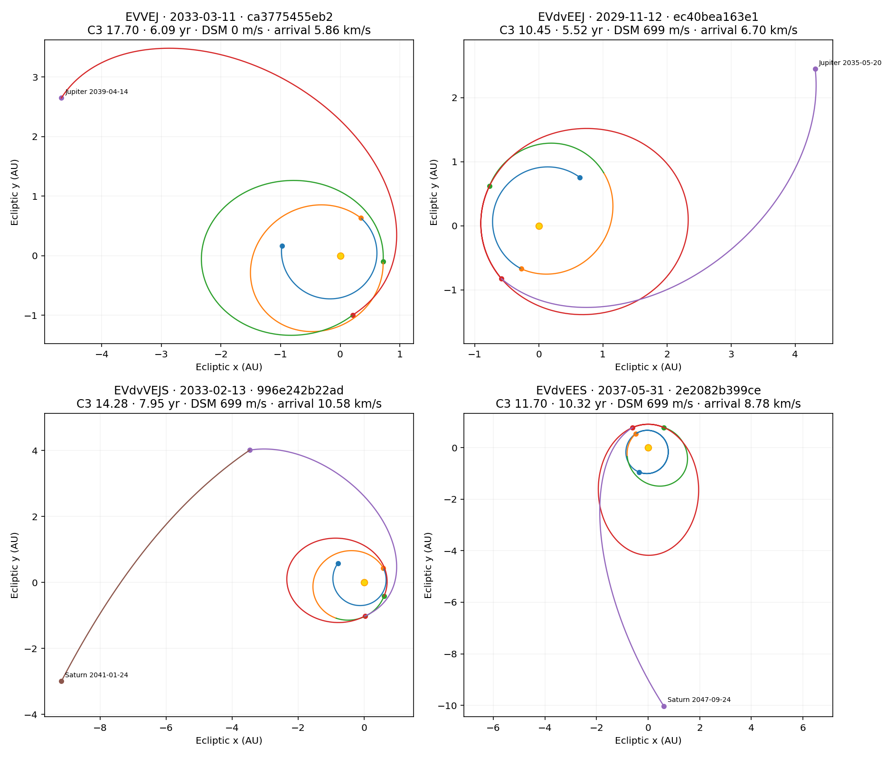
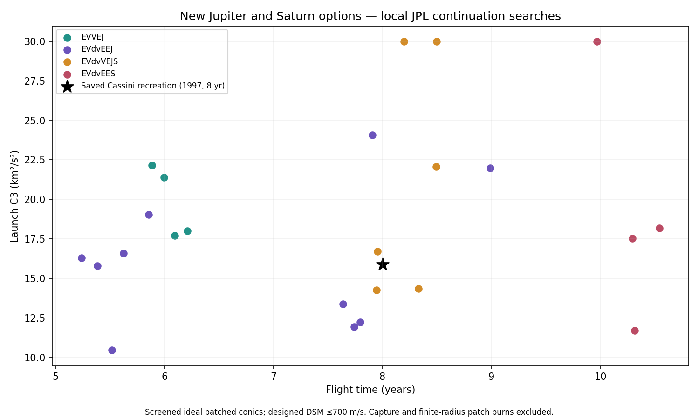

# Jupiter families and a future Cassini-style Saturn route

24 new full-route encounter schedules were independently checked and shared on
November 13, 2026: four EVVEJ, ten EVdvEEJ, six EVdvVEJS and four EVdvEES.
Eligible intermediate planetary prefixes bring the upload to 64 science records.
These are original designs, not reproductions of operational mission states.

| Example | Launch TDB | Arrival TDB | C3, km²/s² | Years | Designed DSM, m/s | Arrival V∞, km/s |
|---|---|---|---:|---:|---:|---:|
| [EVVEJ](https://robertbarthellgaray.github.io/RoLaMGAS/#mission=ca3775455eb261e77e732d1d2cd3e4d247357bbbfb25a8ffc04ae559c26f503a) | 2033-03-11 | 2039-04-14 | 17.701 | 6.094 | 0 | 5.863 |
| [EVdvEEJ](https://robertbarthellgaray.github.io/RoLaMGAS/#mission=ec40bea163e1beaa27bb9685608b20850d7ade10435fa06222bcf6c02987e8e3) | 2029-11-12 | 2035-05-20 | 10.454 | 5.518 | 699.3 | 6.700 |
| [Fast EVdvVEJS](https://robertbarthellgaray.github.io/RoLaMGAS/#mission=996e242b22adad5a9cda8f4432d41243e2867c6b89107b8218759e570430ba75) | 2033-02-13 | 2041-01-24 | 14.279 | 7.947 | 699.0 | 10.584 |
| [EVdvVEJS](https://robertbarthellgaray.github.io/RoLaMGAS/#mission=187873fb362c5f5b397751c08bbae5290d8a0dcf3d0a93a9d23474b38f494bd6) | 2033-02-14 | 2041-06-15 | 14.343 | 8.332 | 699.0 | 9.325 |
| [EVdvEES, without Jupiter](https://robertbarthellgaray.github.io/RoLaMGAS/#mission=2e2082b399ceca3d8ee029be5d15464b46685dd64a87e242af85c05fa6a4ed422) | 2037-05-31 | 2047-09-24 | 11.701 | 10.316 | 699.0 | 8.781 |
| Saved Cassini recreation, later arrival | 1997 | 2005 | 15.897 | 8.000 | 412.4 | 4.541 |

The future Cassini architecture is feasible in this ideal model, but does not
match the saved recreation's combined time, cruise burn and arrival speed.
Two new Saturn routes meet the owner's eight-year cutoff, but have arrival
V∞ above 10 km/s. The low-energy route without Jupiter takes longer.

The actual Cassini mission reached Saturn in about 6.7 years using two Venus
assists, Earth and Jupiter, with a DSM between the Venus encounters. Its flown
trajectory is distinct from the later-arrival recreation in this library.
Sources: [NASA mission timeline](https://science.nasa.gov/mission/cassini/the-journey/timeline/)
and [NASA December 1998 maneuver report](https://science.nasa.gov/missions/cassini/significant-event-report-for-week-ending-1241998/).





## Search and validation

The study made 73 continuation attempts from stored physical candidates,
retaining their Lambert branches while varying encounter dates and DSM
controls. Four launches fell outside the 2027–2055 study interval and were
skipped. Of the 17 passing distinct schedules, a zero-DSM rewrite of an
existing ballistic route was excluded. Nine further Saturn refinements minimized
time, C3 and arrival speed separately using SLSQP with explicit flyby-speed
equalities and turn/budget inequalities. Four stopped at the iteration limit;
three of those final iterates independently pass screening, but are not claimed
optimal. The fourth failed the burn, C3 and flyby constraints and was excluded.
Eight refinements passed. Introducing a DSM into the 7.8-year ballistic route
was separately constrained to remain below eight years.

Launch C3 is restricted to 5–30 km²/s², individual and total designed DSM to
700 m/s, unpowered flyby speed mismatch to 1 m/s, Earth altitude to at least
200 km and Venus to 300 km. Jupiter routes are limited to nine years, routes
to Saturn via Jupiter to 8.5 years, and no-Jupiter Saturn routes to 12 years.
Arrival V∞ is limited to 12 km/s. Launch and downstream windows have finite
widths: this is neither an exhaustive survey nor a proof that other years lack
better opportunities. An eight-year Earth–Venus recurrence does not preserve
the Jupiter/Saturn geometry.

Every published route was re-evaluated against cached JPL vectors. C3 was
independently recomputed from spacecraft departure velocity minus Earth
velocity. Independent DOP853 integration of every solar coast agrees with its
endpoint within **0.028803 km**; the largest retained flyby speed gap is
**0.000408 m/s**. Every record passed the production public-record validator.

These are Sun-only Lambert arcs with asymptotic unpowered flyby screening,
not finite-radius encounter integrations or n-body collision audits. The
listed DSM excludes launch injection, finite-SOI targeting corrections and
arrival capture. A DSM on the leg after Venus cannot replace Jupiter's
gravity assistance without changing the rest of the geometry and budget.

Full metrics and epochs: [comparison.csv](comparison.csv).
Physical states and DSM controls: [public_candidates.json](public_candidates.json).
Search failures are retained in [search_report.json](search_report.json);
refinement convergence in [refinement_report.json](refinement_report.json);
numerical checks in [coast_audits.json](coast_audits.json).

## Run on local hardware

From the source checkout, with the existing one-day JPL planet cache:

```powershell
python tools/search_assist_families.py --output runs/assist_families --workers 2
python tools/refine_assist_families.py --input runs/assist_families --include-zero
python tools/report_assist_families.py --input runs/assist_families --output studies/assist_families
```

The first command checkpoints each attempt. The bundled public archive supplies
the starting candidates. All calculation runs locally. Publishing requires the
report command's explicit `--publish` flag.

“No feasible solution, try lower M” is a Lambert branch error: M counts complete
solar revolutions on one leg. The selected dates do not permit that many
revolutions for those endpoints. Try a smaller M, a longer leg or different
dates; it is not a verdict on the full assist sequence. See the
[Izzo Lambert algorithm](https://arxiv.org/abs/1403.2705).
