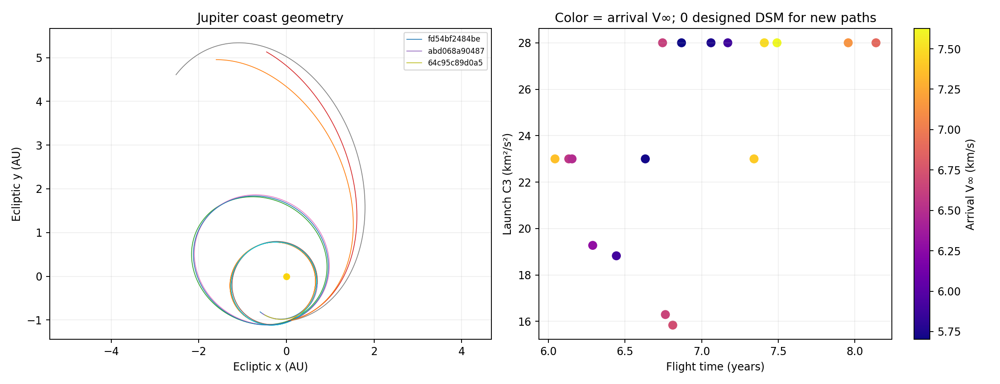
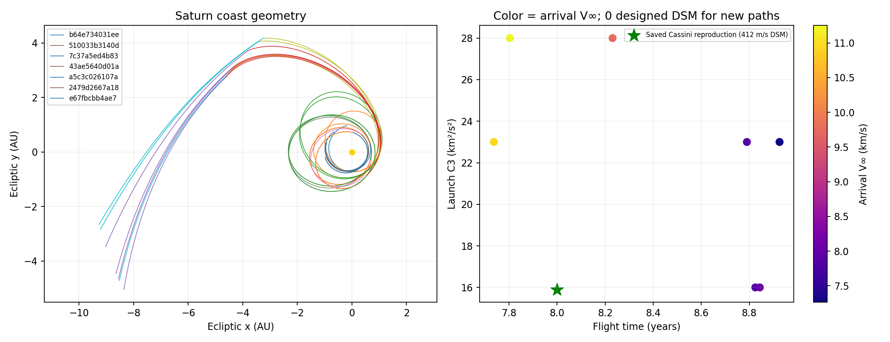

# Low-energy departures and the early-2030s search

The launch-energy calculation is consistent with the saved trajectories. A
separate subtraction of the JPL Earth velocity from each initial spacecraft
velocity reproduces the high and low C3 values. It does not establish that the
optimizer found the best trajectory for a year or sequence.

For example, saved EVEEJ departures on 2029-10-02 and 2031-01-04 have C3
13.42175 and 83.81798 km²/s² respectively. Their departure excess-velocity
components in the Sun/Earth RTN frame are approximately [2.281, -2.867, -0.042]
and [8.392, -3.657, 0.146] km/s. The second path requires much more radial
velocity. Expensive Earth-return DSM examples similarly contain large radial
departure components; they are not a unit conversion or plotting error.

The old library also contained accepted results close to a C3 search ceiling
of 100. Feasibility is not energy minimization. Reusing historical timing in a
different year does not preserve the planetary geometry or guarantee that a
local optimizer enters the cheaper solution basin.

## Missing search coverage

The built-in EVEEJ template allowed only 45–500 days for Venus–Earth. The
newly found May 2031 family using the one-revolution high-path Venus–Earth
branch needs about 674–676 days. Some initial Earth–Venus solutions also took
less than the old 90-day minimum. These valid starting points were outside the
template, even though their branches were supported by the Lambert solver.

Outer-planet templates now cover Earth–Venus departures down to 45 days and
up to 700 days, and Venus–Earth legs up to 900 days. Branch selection explicitly
reserves the coherent [0 low, 1 high, 1 low, 0 low] EVEEJ combination. The best
polished C3 15.84 case belongs to a different family that fits inside the old
timing bounds; new physically connected seeds helped reach that basin. The
timing bug alone does not explain every missed cheap trajectory.

## New results

[comparison.csv](comparison.csv) lists all 24 checked results: 13 root-tree
Jupiter paths, four polished May-2031 Jupiter paths, and seven Saturn paths.
Every result passes a fresh full-chain flyby screen, an independent DOP853
solar-coast check, and the same exact-candidate importer used by the app.
Each folder contains its full candidate, portable settings, audit and plot.
The gallery links and canonical public IDs are in [website_links.json](website_links.json).

| Launch TDB | Jupiter arrival TDB | C3 km²/s² | Years | Arrival V∞ km/s | Designed DSM |
|---|---|---:|---:|---:|---:|
| 2031-05-18 11:00:49 | 2038-03-10 06:30:38 | 15.840 | 6.811 | 6.716 | 0 |
| 2031-05-22 07:43:05 | 2037-10-30 14:13:19 | 18.825 | 6.443 | 5.901 | 0 |
| 2031-05-18 08:23:47 | 2037-08-31 04:56:55 | 19.275 | 6.288 | 6.285 | 0 |
| 2031-05-15 00:00:00 | 2037-05-29 (see CSV for time) | 23.000 | 6.042 | 7.365 | 0 |



The Saturn sweep tested 288 fixed launch-date/C3 combinations: the first of
each month in 2030–2035, at C3 12, 16, 23 and 28, with flight time below nine
years. Seven passed, all launching in 2033. At C3 16, the new paths take about
8.83–8.84 years and arrive at about 7.85–8.14 km/s. A C3 23 path takes 7.74
years but arrives at 10.94 km/s. These are different trades, not replacements
for the saved Cassini reproduction's C3 15.897, 8.000 years, 412.4 m/s DSM and
4.541 km/s Saturn arrival excess speed. That reproduction arrives later than
the actual Cassini mission and is not the flown mission's navigation solution.



Neither of two 14-start local DSM refinements (mid-leg and later-leg burn
initializations) found a Saturn case below 6.5 km/s arrival speed within the
other study bounds. This is a finite search, not an infeasibility proof.

## Defaults and archived examples

Venus-assisted routes visiting an outer planet now have an additional default
C3 ceiling of 30. The advanced setting `max_venus_c3` can be raised or set to
null for a deliberate high-energy search. The lower of that ceiling and the
global maximum is enforced before evaluating the rest of a trial. It is a
search preference, not a physical upper limit. Direct departures, Earth-only
assists and Mercury missions retain the global C3 bounds.

The public example library uses the same 30 ceiling. Forty-five higher-energy
examples were removed from the public archive and D1 library, with full
backups and a restoration script retained locally. Their public science
records are preserved in [archived_high_c3_venus.json](archived_high_c3_venus.json).
They are archived as unsuitable default examples, not labeled impossible.
Personal search history and existing exports were left intact.

## Repeat independently

```powershell
python tools/search_fast_saturn.py --target Jupiter --date 2031-05-15 --c3 23 --max-c3 29.999 --max-years 9.999 --first-leg-max-days 700 --cache "$env:LOCALAPPDATA\RoLaMGAS\cache" --output runs/may2031
python tools/search_fast_saturn.py --target Saturn --monthly --start-year 2030 --end-year 2035 --c3 12 --c3 16 --c3 23 --c3 28 --max-c3 29.999 --max-years 8.99999 --first-leg-max-days 700 --cache "$env:LOCALAPPDATA\RoLaMGAS\cache" --output runs/cassini_future
```

The root search is Sun-only between planetary encounters, with equal-speed
unpowered flyby turns and minimum altitudes. Zero designed DSM excludes launch
injection, finite-radius targeting corrections and arrival capture. Neither
the numerical coast audit nor these files establish n-body flyby clearance.
