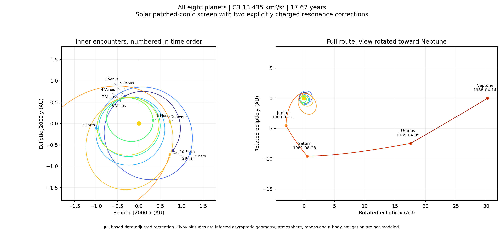
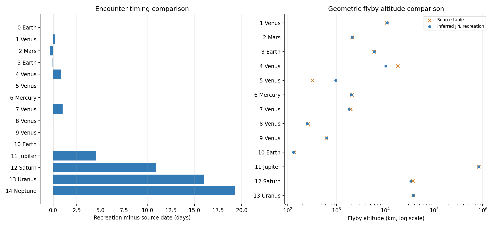

# Eight-planet RSS/Principia itinerary: JPL patched-conic recreation

Original RSS/Principia trajectory design by **ReachStar on Bilibili**. Date-adjusted JPL recreation in RoLaMGAS.

This is a date-adjusted reconstruction of a user-supplied game trajectory, not a flown mission or an exact Principia replay.

C3: **13.435290 km²/s²**. Impulsive injection from 200 km circular Earth orbit: **3.818529 km/s**. Duration: **17.66663 years**.

The two explicitly modeled solar midpoint corrections total **0.027266 m/s**. This is not the n-body navigation budget. The source table's fourteen TCMs total **4.54 m/s**.

Largest flyby excess-speed mismatch: **0.00038666 m/s**. All configured flyby turns pass: **True**.

The screenshot corrects the first Venus flyby from December 13 to **December 23, 1970**. Its launch time is inferred from TCM-1 and elapsed time. The game clock time scale is unspecified; its printed times are treated as TDB here.

Research exceptions: the 1975 Venus floor is 250 km and the 1978 Earth floor is 130 km, following the particularly low source passes (261.7 and 136.2 km). Application and public-library defaults remain unchanged. Atmospheric drag, heating, terrain, moon encounters and navigation uncertainty are excluded.

The saved coast segments meet at ideal planet-center nodes. Inferred periapses screen whether unpowered asymptotes can turn sufficiently; they are not resolved finite-radius flybys. Do not use these center-node coasts as a ready-to-render collision-free Celestia addon. Desktop finite-radius export is a separate calculation and may add corrections.





| Encounter | Source table | JPL recreation (TDB) | Shift (days) | Inferred altitude (km) |
|---|---|---|---:|---:|
| 0 Earth | 1970-08-14 08:04:00 | 1970-08-14 07:37:14 | -0.01859 | — |
| 1 Venus | 1970-12-23 07:15:00 | 1970-12-23 11:56:45 | +0.19567 | 11,013.27 |
| 2 Mars | 1971-08-29 23:34:00 | 1971-08-29 14:25:03 | -0.38121 | 2,104.40 |
| 3 Earth | 1972-03-26 11:24:00 | 1972-03-26 09:37:39 | -0.07385 | 5,985.08 |
| 4 Venus | 1972-11-02 01:32:00 | 1972-11-02 20:49:01 | +0.80349 | 10,319.88 |
| 5 Venus | 1973-06-15 13:17:00 | 1973-06-15 13:39:03 | +0.01532 | 969.09 |
| 6 Mercury | 1974-07-25 22:45:00 | 1974-07-25 22:23:37 | -0.01484 | 2,016.90 |
| 7 Venus | 1974-09-04 08:26:00 | 1974-09-05 08:30:23 | +1.00305 | 1,814.01 |
| 8 Venus | 1975-04-18 00:41:00 | 1975-04-18 01:19:22 | +0.02665 | 251.42 |
| 9 Venus | 1976-04-26 17:32:00 | 1976-04-26 17:49:09 | +0.01192 | 636.25 |
| 10 Earth | 1978-08-07 21:57:00 | 1978-08-07 21:22:39 | -0.02385 | 131.99 |
| 11 Jupiter | 1980-02-17 07:52:00 | 1980-02-21 21:59:54 | +4.58883 | 831,343.16 |
| 12 Saturn | 1981-08-12 22:38:00 | 1981-08-23 20:09:17 | +10.89673 | 33,792.44 |
| 13 Uranus | 1985-03-20 11:40:00 | 1985-04-05 11:12:21 | +15.98081 | 37,745.88 |
| 14 Neptune | 1988-03-25 18:34:00 | 1988-04-14 01:17:13 | +19.28002 | — |

Files: `best.json` is the shooting result; `candidate.json` is the normal desktop-model recomputation; `selected-trajectory.json` imports the exact saved candidate into RoLaMGAS; `validation.json` contains independent solar integrations, scalar-vector checks and desktop re-import checks. The separate standard public-catalog audit retains its stricter default altitude floors.

Offline verification from the repository root:

```powershell
.venv\Scripts\python.exe tools/recreate_eight_planet_tour.py --audit-json studies/eight_planet_tour/verified_source_recreation/best.json --output runs/eight_planet_recheck
```

Add `--fetch` if the historical ephemeris cache is missing. For a fresh local exploration use `--fetch --shooting --polish --window-days 35 --attempts 4`; failed trials are saved with their actual mismatches and constraints. For constrained refinement of this saved result use `--seed-json studies/eight_planet_tour/verified_source_recreation/best.json --polish --window-days 35 --output runs/eight_planet_refine`. No AI service or trajectory upload is involved.
