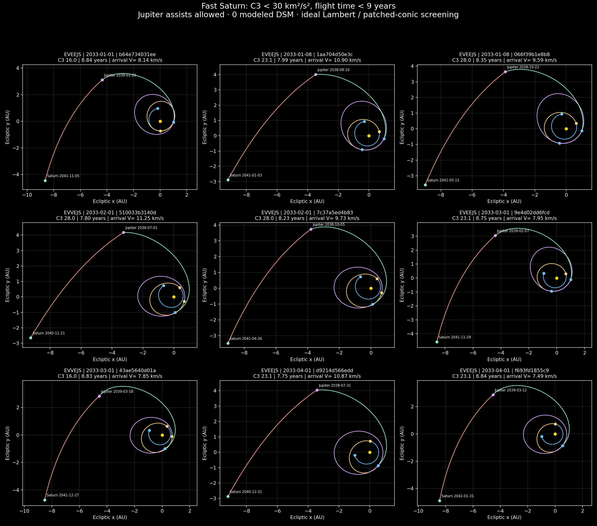
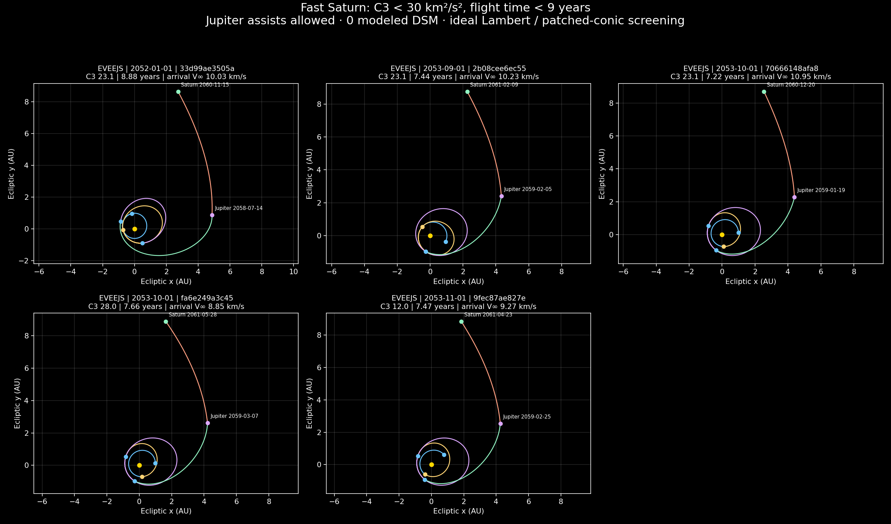
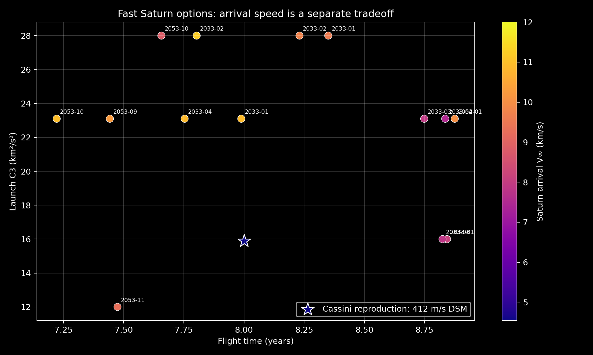

# Fast Saturn launch-window study

1316 fixed launch-date/C3 jobs; 14 passing candidates. Launch years searched: 2030–2056. C3 grid: 12, 16, 23.1, 28 km²/s². Monthly dates plus five initial trial dates. Every published case has C3 < 30 and total flight time < 9 years.

Routes: EVVEJS and EVEEJS, using unpowered Venus, Earth and Jupiter assists. Minimum inferred flyby altitudes: Venus 300 km, Earth 200 km, Jupiter 10,000 km. Maximum speed mismatch 0.1 m/s; each stored case also has an independent DOP853 solar-coast check. All 14 records were uploaded and read back from the shared library.

Zero modeled DSM does not include launch injection, arrival capture or finite-SOI targeting corrections. These are ideal Sun-only Lambert arcs joined at planet centers, with asymptotic flyby-turn screening. They are not resolved n-body flybys.

The saved Cassini reproduction has C3 15.897, 8.000 years, a 412.4 m/s DSM and Saturn arrival V-infinity 4.541 km/s. Every new candidate has a higher arrival speed; they meet the requested C3/time criteria but do not improve every mission cost. The previous no-Jupiter survey imposed a different route constraint.

No passing case was found at the other sampled launch dates, but this finite grid does not prove those years impossible. A 60-window Cassini-DSM reseeding experiment and nine local arrival-speed refinements found no additional solution under 6.5 km/s arrival speed, 700 m/s DSM, C3 < 30 and nine years.

## Interactive candidates

| Candidate | Sequence | Launch TDB | Arrival TDB | Years | C3 km²/s² | Arrival V∞ km/s |
|---|---|---|---|---:|---:|---:|
| [b64e734031ee](https://robertbarthellgaray.github.io/RoLaMGAS/#mission=88e68c5444c0993f5915800ab1375d8ae4e0a90b731e4d1e3825ff7b268900bd) | EVEEJS | 2033-01-01 | 2041-11-05 | 8.844 | 16.000 | 8.137 |
| [1aa704d50e3c](https://robertbarthellgaray.github.io/RoLaMGAS/#mission=df4c6f13eb314a49b9b960247f3d707c16bd75a5e63ace3925ee952ba06a10b4) | EVEEJS | 2033-01-08 | 2041-01-03 | 7.989 | 23.100 | 10.899 |
| [066f39b1e8b8](https://robertbarthellgaray.github.io/RoLaMGAS/#mission=2192d545f519c7eafe6e179840b517d1e2466a65f9a11a4e3dc3fbd025ce535f) | EVEEJS | 2033-01-08 | 2041-05-15 | 8.350 | 28.000 | 9.592 |
| [510033b3140d](https://robertbarthellgaray.github.io/RoLaMGAS/#mission=a14cfe46da37987ac282e773ce009c6c2e32e442b3e2d2111e13c30bbc8020f2) | EVVEJS | 2033-02-01 | 2040-11-21 | 7.803 | 28.000 | 11.249 |
| [7c37a5ed4b83](https://robertbarthellgaray.github.io/RoLaMGAS/#mission=f001454c5099d65bd1bc02de46394657fe4b4ee00b1eb11564329aaa46883b4b) | EVVEJS | 2033-02-01 | 2041-04-26 | 8.231 | 28.000 | 9.734 |
| [9e4d02dd6fcd](https://robertbarthellgaray.github.io/RoLaMGAS/#mission=837d0bb3a05cf5f52793c515b51503d9cd837021d5f666a5afc4dc3f32dd4cff) | EVEEJS | 2033-03-01 | 2041-11-29 | 8.749 | 23.100 | 7.948 |
| [43ae5640d01a](https://robertbarthellgaray.github.io/RoLaMGAS/#mission=228b72d04f0743ef0dce54c59d097c29b4cf295ed176ada709897d09af18c656) | EVVEJS | 2033-03-01 | 2041-12-27 | 8.825 | 16.000 | 7.846 |
| [d9214d566edd](https://robertbarthellgaray.github.io/RoLaMGAS/#mission=82328e284a7e2eddb41b7c695be2dbc542283e83beefb0d01989bcebdd65414c) | EVEEJS | 2033-04-01 | 2040-12-31 | 7.754 | 23.100 | 10.868 |
| [f693fd1855c9](https://robertbarthellgaray.github.io/RoLaMGAS/#mission=2b1becaeb181aefd0b93a50ff08a0d1be615e63d6eb04ac947e344ff55045f30) | EVEEJS | 2033-04-01 | 2042-01-31 | 8.836 | 23.100 | 7.487 |
| [33d99ae3505a](https://robertbarthellgaray.github.io/RoLaMGAS/#mission=e5a556faec29a945a1933f2cf6d2b8d4ce54001dd2e31452dbed2e4d36ac3ea0) | EVEEJS | 2052-01-01 | 2060-11-15 | 8.876 | 23.100 | 10.027 |
| [2b08cee6ec55](https://robertbarthellgaray.github.io/RoLaMGAS/#mission=9e49023f6f889fd9fcef59fa0a147179476cca685d7caeeb5b013ca626b1e47a) | EVEEJS | 2053-09-01 | 2061-02-09 | 7.443 | 23.100 | 10.226 |
| [70666148afa8](https://robertbarthellgaray.github.io/RoLaMGAS/#mission=ee4b9e41826beaf93a55f1abce9b3f4fb68632afbc76a74a17d707506335d2b7) | EVEEJS | 2053-10-01 | 2060-12-20 | 7.222 | 23.100 | 10.954 |
| [fa6e249a3c45](https://robertbarthellgaray.github.io/RoLaMGAS/#mission=070c5db14699c824b37791c379888dc2fb893a8e800ccce6f47dc4dec2b3a687) | EVEEJS | 2053-10-01 | 2061-05-28 | 7.657 | 28.000 | 8.847 |
| [9fec87ae827e](https://robertbarthellgaray.github.io/RoLaMGAS/#mission=21873090fe171724f19cd6d969ec4dce5438e2f3764e718b57404b1d29d42652) | EVEEJS | 2053-11-01 | 2061-04-23 | 7.474 | 12.000 | 9.265 |

## Pictures and reuse







Each `<id>.json` imports the exact candidate. `<id>.options.json` imports its settings and candidate. `<id>.full.json` contains solver output and the coast audit. Additional public records and upload verification are saved alongside them.

```powershell
python tools/search_fast_saturn.py --monthly --start-year 2030 --end-year 2056 --workers 4 --output runs/fast_saturn
python tools/report_fast_saturn.py --input runs/fast_saturn --output studies/fast_saturn
```

The reporter uses `review/website_links.json` created during publication to link local IDs to public canonical IDs. Searches run on the local CPU with the cached daily JPL data. Existing date/C3 checkpoints are skipped.
