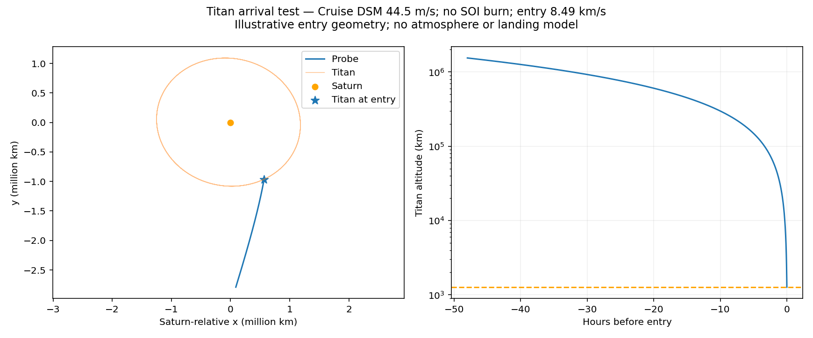

# Direct Titan arrival prototype

This standalone arrival corrector uses the saved `6ef2b7edc240` EdvES
Dragonfly-style route. It is not an official Dragonfly trajectory or a new GUI
search mode. Entry is fixed at the source candidate's date,
**2035-11-27 20:26:26 TDB**. Existing trajectories and downloads are unchanged.

Dragonfly uses direct atmospheric entry and landing. NASA describes entry
interface at 1,270 km altitude and an atmosphere-relative speed above 7 km/s.
[NASA entry-vehicle study](https://ntrs.nasa.gov/citations/20250011502).

| Test | Added Saturn-SOI burn | Added cruise DSM | Change to Earth departure vector | Titan-relative inertial entry speed |
|---|---:|---:|---:|---:|
| Preserve the saved final solar coast | 410.5 m/s | 0 | 0 | 8.29 km/s |
| Sun-only Lambert from the final Earth encounter to Titan | 284.9 m/s | 0 | 38.5 m/s | 8.37 km/s |
| Jointly target solar and Saturn/Titan arcs from an earlier cruise DSM | **0** | **44.54 m/s** | **0** | **8.49 km/s** |

The 38.5 m/s difference between Lambert departure vectors is not a validated
flyby burn cost. That case needs upstream flyby-speed and turn reoptimization.
The third case preserves all previous legs and flybys, applying one real
cruise correction on **2033-10-12 10:25:14 TDB**. Velocity is continuous at
Saturn's SOI on **2035-08-30 14:55:11 TDB**. The source's 414.72 m/s designed
DSM plus the additional correction totals **459.27 m/s modeled cruise Δv**.
Launch injection, other finite-radius corrections and descent are separate.
The burn epoch is a fixed midpoint test, not a globally optimized minimum.



## Method and validation

Solve a Sun-only Lambert arc from the cruise correction point to Saturn's SOI,
then a Saturn-centered Lambert initial guess to a finite Titan entry point.
Differentially correct the local arc using Saturn and Titan point-mass gravity,
including the indirect acceleration of the Saturn-centered origin. Jointly
adjust the SOI crossing direction and epoch until all three velocity components
match. No SOI impulse is applied.

An independent DOP853 propagation of the solar coast carries its numerical
state directly into the Saturn/Titan integration. The solar boundary error is
0.000023 km, and the final entry-point residual is below **0.001 km**. These
are numerical consistency checks, not estimates of navigation accuracy or JPL
interpolation error. Seven dynamics tests pass, including known circular
motion, finite-difference gravity/sensitivity checks and endpoint shooting.

The entry point is illustrative. Its actual flight-path angle is about
**−51.45°**; entry corridor, heat load and landing site are not optimized.
Speed is **Titan-relative inertial**, not atmosphere-relative. Propagation
stops at entry interface. Drag, heating, parachutes and landing are absent.
Local gravity omits solar tides, other moons, Saturn J2 and rings, so this is
not a complete collision or navigation audit. Saturn vectors have one-day
cadence and Titan vectors hourly cadence; detailed entry design needs finer
data and a broader model. Titan GM 8978.13710 km³/s² and radius 2574.76 km
come from [JPL SAT441 parameters](https://ssd.jpl.nasa.gov/sats/phys_par/).

## Run locally

From the source checkout and Python environment:

```powershell
python tools/target_titan_arrival.py --case docs/data/cases/6ef2b7edc240.json --output runs/dragonfly_titan_saved
python tools/target_titan_arrival.py --case docs/data/cases/6ef2b7edc240.json --output runs/dragonfly_titan_moon_seed --heliocentric-seed moon
python tools/target_titan_arrival.py --case docs/data/cases/6ef2b7edc240.json --output runs/dragonfly_titan_upstream --upstream-burn-fraction 0.5
```

Missing JPL data is downloaded and cached. Calculation runs locally; joint
targeting can take several minutes. The GUI retains its safeguard against
unsupported direct Sun-only moon searches. These arcs are not shared as
ordinary planet-center Lambert candidates.

Each run writes a report, plot and Saturn-centered/heliocentric CSV and XYZV
arrival segments. The upstream case also writes
`cruise_and_arrival_heliocentric.csv` and `.xyzv`, starting just after the
additional DSM. These are separate segments, not launch-to-landing addons.
Coordinates are Ecliptic J2000, km and km/s, with TDB Julian dates. Select the
matching parent frame when importing a Saturn-centered file. Full sampled
files are in local `runs/dragonfly_titan_*` folders.

Reports: [comparison.csv](comparison.csv), [upstream_report.json](upstream_report.json),
[saved_report.json](saved_report.json), [moon_seed_report.json](moon_seed_report.json).
