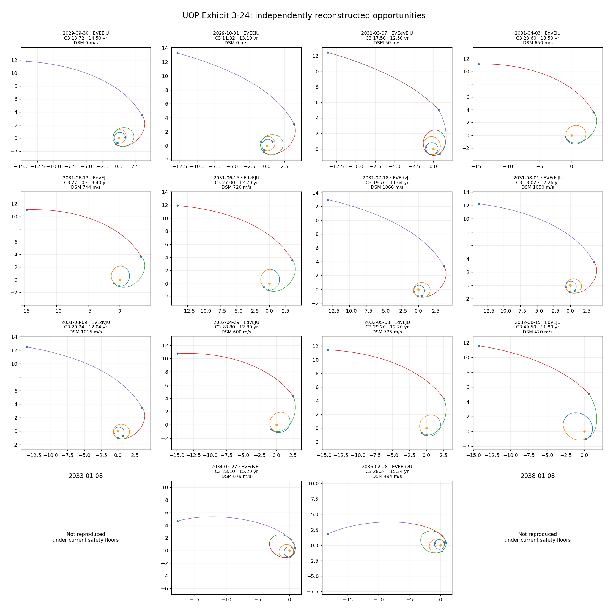

# UOP launch-opportunity reconstructions

Source: Uranus Orbiter and Probe mission concept report, Exhibit 3-24, printed p.25 (PDF p.31).

14 of 16 reference opportunities have passing reconstructions. Launch calendar days match; C3 and flight times are compared to rounded report values. These are independently solved trajectories, not recovered official state histories.

The two unresolved windows remain explicitly marked; their sub-floor periapses are not published as passing. Earth ≥200 km, Venus ≥300 km and Jupiter ≥10,000 km are retained.

Checks: full-chain re-evaluation, flyby speed mismatch below 0.01 m/s and independent DOP853 solar propagation. Capture/UOI, finite-radius export corrections and n-body propagation are not included. Report UOI costs and post-capture masses were not recreated.

Some reference DSMs exceed the ordinary 700 m/s cap. Each `examples/uop_DATE.options.json` carries the appropriate explicit study budget and the full candidate. The community library also supplies the passing routes to installed clients without a binary update.

| Reference launch | Sequence | C3 | DSM m/s | Years | Status |
|---|---|---:|---:|---:|---|
| 2029-09-30 | EVEEJU | 13.72 | 0.0 | 14.501 | Passing Lambert reconstruction |
| 2029-10-31 | EVEEJU | 11.32 | 0.0 | 13.099 | Passing Lambert reconstruction |
| 2031-03-07 | EVEdvEJU | 17.50 | 50.0 | 12.500 | Passing Lambert reconstruction |
| 2031-04-03 | EdvEJU | 28.60 | 650.0 | 13.500 | Passing Lambert reconstruction |
| 2031-06-13 | EdvEJU | 27.10 | 744.2 | 13.400 | Passing Lambert reconstruction |
| 2031-06-15 | EdvEJU | 27.00 | 720.0 | 12.700 | Passing Lambert reconstruction |
| 2031-07-18 | EVEdvJU | 19.76 | 1066.0 | 11.640 | Passing Lambert reconstruction |
| 2031-08-01 | EVEdvJU | 18.02 | 1050.0 | 12.261 | Passing Lambert reconstruction |
| 2031-08-09 | EVEdvJU | 20.24 | 1015.4 | 12.040 | Passing Lambert reconstruction |
| 2032-04-29 | EdvEJU | 28.80 | 600.0 | 12.800 | Passing Lambert reconstruction |
| 2032-05-03 | EdvEJU | 29.20 | 725.5 | 12.200 | Passing Lambert reconstruction |
| 2032-08-15 | EdvEJU | 49.50 | 420.0 | 11.800 | Passing Lambert reconstruction |
| 2033-01-08 | — | 0.00 | 0.0 | 0.000 | Not reproduced under stated safety floors |
| 2034-05-27 | EVEdvEU | 23.10 | 679.4 | 15.200 | Passing Lambert reconstruction |
| 2036-02-28 | EVEEdvU | 28.24 | 494.5 | 15.340 | Passing Lambert reconstruction |
| 2038-01-08 | — | 0.00 | 0.0 | 0.000 | Not reproduced under stated safety floors |

Re-run locally: `python tools/reconstruct_uop_opportunities.py --workers 3`, then `python tools/finalize_uop_opportunities.py --site PATH_TO_REPO` after reviewing the results. The search requires cached one-day Earth/Venus/Jupiter/Uranus JPL coverage over 2028–2056 and a saved Uranus library snapshot at the run directory. `--share` is required to write to the public service.
